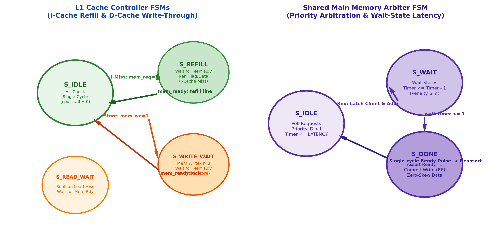
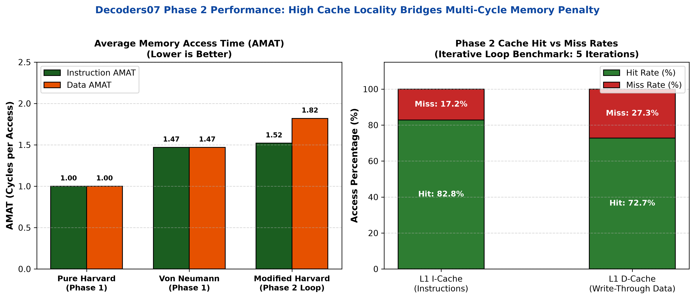

# Instruction and Data Memory Hierarchy (Project 9)
### Modern Computer Architecture (MCA) — Phase I & Phase II Complete
**Team: Decoders07**

[](https://en.wikipedia.org/wiki/Verilog)
[](https://steveicarus.github.io/iverilog/)
[]()
[]()

---

## 👥 Team Decoders07 — Members & Roles

| Name | Roll Number | Individual Project Specialization |
|---|---|---|
| **Anant Jain** | `2401010066` | Program Counter, L1 Instruction Cache (I-Cache) & Tag Checking FSM Lead |
| **Vipul Sharma** | `2401010505` | Data Memory Subsystem, L1 Data Cache (Write-Through) & Core Stall Coupling Lead |
| **Krishna Gehlot** | `2401010236` | Address Decoder, Shared Main Memory Priority Arbiter ($D > I$) & Wait-State Lead |
| **Aditya Kumar** | `2401010029` | Multi-Benchmark Assembler, 3-Way Comparative Benchmark & AMAT Modeling Lead |
| **Kartik Mehra** | `2401020030` | Automated Assertion Verification Suites, Waveform Analysis & IEEE Report Lead |

*Department of Computer Science and Engineering, Newton School of Technology, Rishihood University, Sonipat, India*

---

## 🎥 Video Demonstration & Deliverables
- **Video Demonstration:** [Watch Video Walkthrough (Google Drive)](https://drive.google.com/file/d/1w4z_5gOMVCfHtYa4Goujhmb_GkWyMnq4/view?usp=sharing)
- **IEEE Project Reports:**
  - **Phase 1 IEEE Report (LaTeX Source):** [docs/report/IEEE_Project_Report_Phase1.tex](docs/report/IEEE_Project_Report_Phase1.tex)
  - **Phase 1 Compiled PDF:** [docs/report/Project_Report_Phase1.pdf](docs/report/Project_Report_Phase1.pdf)
  - **Phase 2 Final IEEE Report (LaTeX Source):** [docs/report/IEEE_Project_Report_Phase2.tex](docs/report/IEEE_Project_Report_Phase2.tex)
- **Interview & Viva Defense Guide:** [docs/interview_defense_guide.md](docs/interview_defense_guide.md) (Complete Q&A for all 5 members)
- **Milestone Plan & Checklist:** [docs/project_plan_phase1_phase2.md](docs/project_plan_phase1_phase2.md)

---

## 📌 Executive Project Overview

Modern high-performance processors face a dual architectural challenge:
1. **Core-Level Structural Contention:** If instructions and data share a single memory bus (Von Neumann), the CPU cannot fetch instructions while accessing data, creating structural hazards.
2. **The Memory Wall:** Off-chip main memory operates significantly slower than the processor core, incurring multi-cycle wait states on every memory transaction.

To resolve both challenges, this project designs and benchmarks two progressive architectural paradigms:
1. **Phase 1 (Pure Harvard vs Von Neumann):** Segregated instruction and data memory paths vs a single-bus unified baseline. Demonstrates an ideal single-cycle execution ($\text{CPI} = 1.00$) and a **$1.47\times$ empirical speedup** over Von Neumann.
2. **Phase 2 (Modified Harvard with Level-1 Caches):** Placing direct-mapped L1 I-Cache and L1 D-Cache units directly adjacent to the core pipelines, backed by a unified multi-cycle main memory with 3-cycle memory wait states. Demonstrates **$82.8\%$ I-Cache Hit Rate** and **$72.7\%$ D-Cache Hit Rate**, preserving high throughput.

---

## 🏛️ Architectural Block Diagrams

### 1. Phase 2: Modified Harvard Architecture with L1 Caches
```
                     +---------------------------------------+
                     |            PROCESSOR CORE             |
                     |     (PC, Registers, ALU, Control)     |
                     +-----------+---------------+-----------+
                                 |               |
               Instruction Bus   |               |   Data Bus
               (Single-Cycle)    |               |   (Byte Enables)
                                 v               v
                     +---------------+   +---------------+
                     |  L1 I-CACHE   |   |  L1 D-CACHE   |
                     | Direct-Mapped |   | Write-Through |
                     |   (16 Lines)  |   |   (16 Lines)  |
                     +-------+-------+   +-------+-------+
                             |                   |
               I_Refill_Req  |                   | D_Req + Write-Through
                             v                   v
                     +---------------------------------------+
                     |       SHARED MAIN MEMORY (4 KB)       |
                     |   Priority Bus Arbiter (D > I)        |
                     |   Multi-Cycle Penalty (3 Cycles)      |
                     +---------------------------------------+
```
*(High-resolution publication diagram: [docs/diagrams/modified_harvard_cache_architecture.png](docs/diagrams/modified_harvard_cache_architecture.png))*

### 2. Phase 2: Cache & Memory Controller FSM State Diagram


### 3. Phase 1: Pure Harvard vs Von Neumann Baselines
- **Harvard Architecture Diagram:** [docs/diagrams/harvard_architecture_block_diagram.png](docs/diagrams/harvard_architecture_block_diagram.png)
- **Von Neumann Comparison Diagram:** [docs/diagrams/von_neumann_comparison_diagram.png](docs/diagrams/von_neumann_comparison_diagram.png)

---

## 📈 Performance Benchmarks & AMAT Evaluation

### 1. Phase 2 Iterative Loop Locality Benchmark
Under an iterative triangular sum workload ($\sum_{k=1}^5 k = 15$), the L1 cache hierarchy effectively shields the core from multi-cycle main memory wait states:

| Performance Metric | L1 Instruction Cache | L1 Data Cache (Write-Through) |
|---|---|---|
| **Total Accesses** | 58 | 11 |
| **Hits (Single-Cycle)** | 48 | 8 (4 Read Hits + 4 Write Hits) |
| **Misses (Refills / Write-Thru)** | 10 | 3 (1 Read Miss + 2 Write Misses) |
| **Empirical Hit Rate (%)** | **82.76%** | **72.73%** |
| **Empirical Miss Rate (%)** | **17.24%** | **27.27%** |
| **AMAT (Cycles per Access)** | **1.52 Cycles** | **1.82 Cycles** |
| **Main Memory Wait States** | \multicolumn{2}{c}{34 Wait Cycles across 17 Transactions} |
| **Total Instructions Executed** | \multicolumn{2}{c}{30 Instructions} |
| **Total Clock Cycles Taken** | \multicolumn{2}{c}{98 Clock Cycles} |



### 2. Comprehensive 3-Way Architecture Benchmark
Evaluated on the identical 15-instruction arithmetic benchmark workload:

| Architectural Metric | Pure Harvard (Phase 1) | Shared Von Neumann (Phase 1) | Modified Harvard (Phase 2 w/ Caches) |
|---|---|---|---|
| **Instructions Executed** | 15 | 15 | 15 |
| **Total Clock Cycles** | **15** | **22** | **103** *(Cold Misses)* |
| **Hazard Stalls / Wait Cycles** | 0 | 7 *(Structural Hazard)* | 44 *(Memory Latency)* |
| **Simultaneous Access Cycles** | 7 | 0 | 7 |
| **Average CPI** | **1.00** | **1.47** | **6.87** *(Linear Stream)* |
| **Instruction Throughput (IPC)** | **1.00** | **0.68** | **0.15** |
| **Instruction AMAT (cycles)** | 1.00 | 1.47 | 2.05 |
| **Data AMAT (cycles)** | 1.00 | 1.47 | 4.00 |
| **Speedup vs Von Neumann** | **1.47x faster** | **1.00x baseline** | **Realistic Multi-Cycle Hierarchy** |

---

## ✅ Automated Self-Checking Assertion Verification

All simulations include self-checking assertion suites verifying register state, data memory values, and cache hits:

```text
==================================================================
             PHASE 2 HARDWARE VERIFICATION RESULTS
==================================================================
  [PASS] Main Memory[0x0000_0100] (Running Sum) = 15 (Expected: 15)
  [PASS] Main Memory[0x0000_0104] (Final Sum)   = 15 (Expected: 15)
  [PASS] Register R1 (Loop Counter) = 0 (Terminated cleanly)
  [PASS] Register R2 (Accumulator)  = 15 (Expected: 15)
  [PASS] Register R3 (Last Loaded)  = 15 (Expected: 15)
  [PASS] L1 I-Cache hit detection verified (48 hits recorded)
  [PASS] L1 D-Cache hit detection verified (4 read hits, 4 write hits)
```

---

## 🚀 How to Run the Simulations

### Prerequisites
- **Icarus Verilog (`iverilog`)** and **`vvp`** runtime
- **Python 3**
- *(Optional)* **GTKWave** for inspecting `.vcd` waveform traces

Install on macOS:
```bash
brew install icarus-verilog gtkwave
```

### 1. Run Phase 2 Cache & AMAT Simulation Suite
```bash
./sim/run_phase2_sim.sh
```
This script:
1. Runs `scripts/phase2_assembler.py` to compile the linear and loop benchmark images.
2. Compiles and executes `tb/tb_cache_system.v` (verifies cache hits, write-through, and loop locality).
3. Compiles and executes `tb/tb_phase2_amat.v` (prints the 3-way architectural comparison table).
4. Generates cycle-accurate waveforms `sim/phase2_cache.vcd` and `sim/phase2_amat.vcd`.

### 2. Run Phase 1 Simulation Suite
```bash
./sim/run_sim.sh
```
Runs the Harvard vs Von Neumann benchmark and verifies all 15 Phase 1 arithmetic assertions.

### 3. Regenerate High-Resolution Diagrams
```bash
python3 scripts/generate_diagrams.py
python3 scripts/generate_phase2_diagrams.py
```

---

## 📁 Repository Directory Structure

```text
Mca_project/
├── rtl/
│   ├── common/                          # Shared Foundation Modules
│   │   ├── program_counter.v            # 32-bit PC with +4 increment & branch redirection
│   │   ├── address_decoder.v            # Memory mapping and word alignment checker
│   │   └── simple_processor.v           # 16-register RISC controller core with ALU
│   ├── harvard/                         # Phase 1 Harvard Architecture Subsystem
│   │   ├── instruction_memory.v        # Dedicated 1 KB instruction memory (ROM/RAM)
│   │   ├── data_memory.v               # Dedicated 1 KB data memory with 4-byte lanes
│   │   ├── memory_controller.v         # Read/write control unit & MMIO registers
│   │   └── harvard_top.v               # Top-level Harvard architecture integration
│   ├── von_neumann/                     # Phase 1 Von Neumann Subsystem
│   │   ├── arbiter.v                   # 2-phase bus arbiter for structural hazard resolution
│   │   └── shared_memory_top.v         # Comparative Von Neumann unified-memory baseline
│   └── cache/                           # Phase 2 Level-1 Cache Subsystem
│       ├── i_cache.v                   # Direct-Mapped L1 I-Cache with Refill FSM
│       ├── d_cache.v                   # Direct-Mapped L1 D-Cache with Write-Through Policy
│       ├── main_memory.v               # Multi-Cycle Shared Main Memory (Priority Arbiter)
│       └── modified_harvard_top.v       # Top-Level Modified Harvard Cache Integration
├── tb/                                   # Verification & Testbenches
│   ├── tb_harvard_memory.v             # Phase 1 Harvard verification testbench
│   ├── tb_shared_vs_harvard.v          # Phase 1 Comparative benchmark testbench
│   ├── tb_cache_system.v               # Phase 2 L1 Cache hierarchy verification testbench
│   ├── tb_phase2_amat.v                # Phase 2 3-Way Comparative AMAT benchmark testbench
│   ├── program.mem                     # Assembled Phase 1 machine code
│   ├── shared_program.mem              # Phase 1 unified memory image
│   ├── phase2_linear_main_mem.mem      # Phase 2 linear benchmark image
│   └── phase2_loop_main_mem.mem        # Phase 2 iterative loop benchmark image
├── sim/                                  # Simulation Automation & Waveforms
│   ├── run_sim.sh                      # Phase 1 automated compile & run script
│   ├── run_phase2_sim.sh               # Phase 2 automated compile & run script
│   ├── generate_waves.sh               # GTKWave launcher
│   ├── harvard_sim.vcd                 # Phase 1 Harvard waveform trace
│   ├── comparison_sim.vcd              # Phase 1 comparison waveform trace
│   ├── phase2_cache.vcd                # Phase 2 cache hierarchy waveform trace
│   └── phase2_amat.vcd                 # Phase 2 3-way AMAT waveform trace
├── docs/                                 # Project Documentation & Deliverables
│   ├── report/
│   │   ├── IEEE_Project_Report_Phase1.tex # Phase 1 Overleaf-ready IEEE LaTeX report
│   │   ├── Project_Report_Phase1.pdf      # Phase 1 compiled project report PDF
│   │   └── IEEE_Project_Report_Phase2.tex # Phase 2 Overleaf-ready IEEE LaTeX report
│   ├── diagrams/                       # High-resolution architectural diagrams (PNG)
│   │   ├── harvard_architecture_block_diagram.png
│   │   ├── von_neumann_comparison_diagram.png
│   │   ├── benchmark_comparison_chart.png
│   │   ├── modified_harvard_cache_architecture.png
│   │   ├── cache_fsm_state_diagram.png
│   │   └── phase2_amat_comparison_chart.png
│   ├── interview_defense_guide.md       # Complete Viva & Interview Defense Guide
│   └── project_plan_phase1_phase2.md    # Milestones & verification checklist
├── scripts/
│   ├── assembler.py                    # Phase 1 benchmark assembler
│   ├── phase2_assembler.py             # Phase 2 multi-benchmark assembler
│   ├── generate_diagrams.py            # Phase 1 diagram generator
│   └── generate_phase2_diagrams.py     # Phase 2 diagram generator
└── README.md                           # Root repository documentation
```

---

## 📜 Academic Integrity & Course Reference
- **Course:** Modern Computer Architecture (MCA), Project 9: *Instruction and Data Memory Hierarchy*
- **Institution:** Newton School of Technology, Rishihood University
- **Team Name:** Decoders07
